  

  
  
  

  

## 🧱 What I build

<table>
<tr>
<td width="50%" valign="top">

**🎮 Games** 
Roblox experiences: training simulators and survival. Live-ops are data: events, updates, badges, game passes and dev products are TOML in the game's repo.

</td>
<td width="50%" valign="top">

**🧩 Studio plugins** 
A suite of Studio plugins in Luau: keyframe animation with an exported runtime, an audio graph editor, an edit-time storybook, an asset explorer, hot module reload into playtests, and a plugin manager that enables and profiles them all. Bundled with **Lune**, installed with one **Go** command.

</td>
</tr>
<tr>
<td width="50%" valign="top">

**🤖 AI tooling** 
MCP servers that let agents work in **Roblox Studio** and **Blender**: copy and sync instances between places, generate 3D assets with Tripo, drive Codex for images. Plus a local app that runs Claude Code and Codex on tasks and hands work between them.

</td>
<td width="50%" valign="top">

**📡 Live-ops panel** 
Keeps experience titles and page galleries in sync with the event schedule: `[🌙 LUNAR NIGHT] My Game` appears when the event starts, countdowns tick in the final hour. **Bun** + **React** + **Docker**.

</td>
</tr>
</table>

## 🛠 Stack

  
  
  

  

`Luau` · `jecs` · `Lune` · `Rokit` · `Go` · `TypeScript` · `Bun` · `MCP` · `Open Cloud` · `Docker` · `Blender`

## 📈 A year of commits

  

  <picture>
    <source media="(prefers-color-scheme: dark)" srcset="https://raw.githubusercontent.com/mathfox/mathfox/output/snake-dark.svg">
    <source media="(prefers-color-scheme: light)" srcset="https://raw.githubusercontent.com/mathfox/mathfox/output/snake.svg">
    
  </picture>

  <picture>
    <source media="(prefers-color-scheme: dark)" srcset="https://raw.githubusercontent.com/mathfox/mathfox/output/pacman-contribution-graph-dark.svg">
    <source media="(prefers-color-scheme: light)" srcset="https://raw.githubusercontent.com/mathfox/mathfox/output/pacman-contribution-graph.svg">
    
  </picture>

  

Everything above is rebuilt every 12 hours by a <a href=".github/workflows/profile-art.yml">workflow</a>; the brick skyline and the punch card are drawn by <a href=".github/scripts">small Python scripts</a>.
